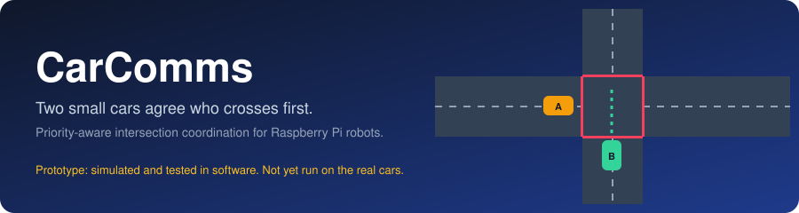
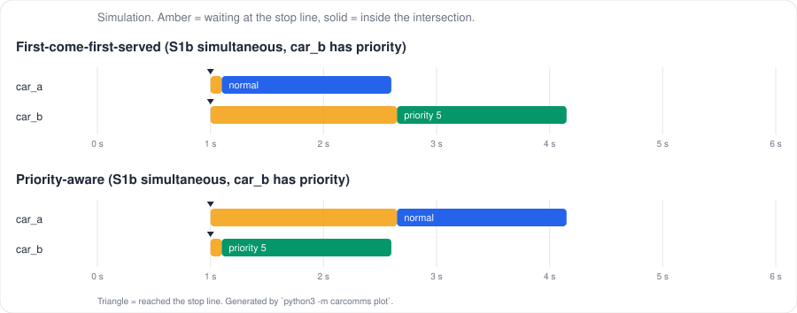
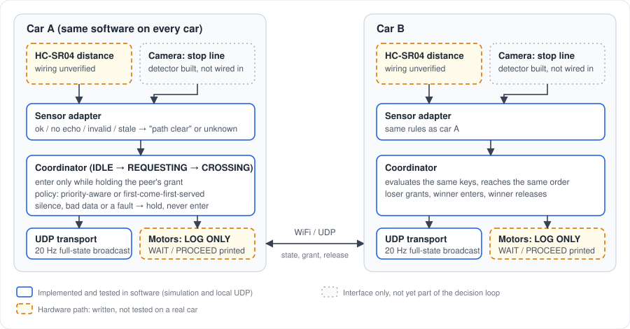
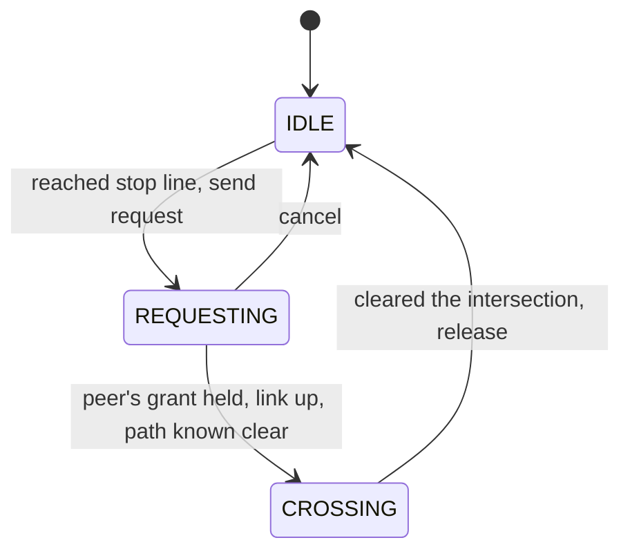

<p align="center">
  
</p>

<h1 align="center">CarComms</h1>

<p align="center"><b>Two small robot cars talk to each other and agree who crosses the intersection first.</b><br>
A car with an urgent need can get priority while the other safely yields. Coordination logic in plain Python, tested in simulation, running as two real UDP processes. Built for two Raspberry Pi 4 cars.</p>

<p align="center">
  <a href="https://github.com/serjdmitri/CarComms/actions/workflows/tests.yml"></a>
  
  
  
  
  <a href="LICENSE"></a>
</p>

<p align="center">
  <a href="#quick-start">Quick start</a> |
  <a href="#see-it">See it</a> |
  <a href="#how-it-decides">How it decides</a> |
  <a href="#results-simulation-only">Results</a> |
  <a href="#hardware">Hardware</a> |
  <a href="#known-limitations">Limitations</a> |
  <a href="#roadmap">Roadmap</a>
</p>

> **Status: prototype.** The coordination software is implemented and tested in simulation and as two local processes talking over real UDP sockets. **It has not been run on the physical cars yet, and nothing here moves a motor** (motion is printed, not performed). The central idea, that priority reduces the priority car's waiting time, is a **hypothesis**. The first simulation shows only a small effect for this protocol; see [Results](#results-simulation-only).

## The problem

Two cars reach an intersection at about the same time. Someone has to go first. If one of them has a time-sensitive reason to get through (think an emergency vehicle), the other should yield. CarComms is a small, testable model of that: each car broadcasts what it wants, both cars apply the same rule, and they end up with the same crossing order without a central controller.

I started this project after reading about preventable deaths in car crashes and wondering whether cars that can talk to each other could avoid some of them. The longer story is in the [original README](docs/prototype-readme.md).

## What works today

| | |
|---|---|
| **Two-car coordination** | Request, grant, enter, exit, release. A car enters only while it holds the other car's grant. Exclusive access for two cars is checked in 200 randomized lossy-network runs. |
| **Explicit priority policy** | Higher priority first, then earlier request, then vehicle id. Deterministic, and both cars compute the same order. A first-come-first-served baseline is included for comparison. |
| **Defined failure behaviour** | Duplicated, stale, delayed, garbage and lost messages; a silent peer; a rebooted peer; invalid or missing sensor readings. Every unknown makes a car hold, never cross. |
| **Two real processes** | `python3 -m carcomms udp-demo` starts two OS processes with real UDP sockets and checks they never share the intersection. |
| **Distance-sensor adapter** | Turns raw HC-SR04 readings into "clear", "blocked" or "unknown". The old `999` no-echo value is no longer silently treated as "clear". |
| **Reproducible experiment** | The same arrival scenarios through both policies. Every number below comes from `python3 -m carcomms experiment`. |
| **Camera interface (optional)** | A stop-line marker detector that runs on recorded frames. Not part of the decision loop yet. |
| **No dependencies** | Standard library only. Runs on a laptop and on a Pi. |

## See it

One simulated run: both cars reach the stop line at the same moment and car B has priority. Command: `python3 -m carcomms simulate`.

```text
t=  1.000  car_a  REQUEST        #1 priority=0 movement=straight ts=1
t=  1.000  car_b  REQUEST        #1 priority=5 movement=straight ts=1
t=  1.050  car_a  GRANT_GIVEN    to car_b #1: yield to car_b (priority 5 vs 0)
t=  1.100  car_b  ENTER          #1 (clear (100 cm))
t=  2.600  car_b  EXIT           #1
t=  2.600  car_b  RELEASE        #1
t=  2.600  car_b  GRANT_GIVEN    to car_a #1: idle
t=  2.650  car_a  ENTER          #1 (clear (100 cm))
t=  4.150  car_a  EXIT           #1
t=  4.150  car_a  RELEASE        #1

crossing order: car_b -> car_a   overlaps: 0   all completed: True
```

The same arrivals under both policies. Amber is waiting at the stop line:

<p align="center">
  
</p>

Priority changes *who* waits. It does not remove the wait: someone still waits for the other car's crossing. This picture is a simulation, generated by `python3 -m carcomms plot`.

## How it works

<p align="center">
  
</p>

Each car runs the same coordinator. Every 50 ms it broadcasts its **complete state** in one small JSON datagram. Because every message is the latest full state and not a change, a lost message is repaired by the next one.



## How it decides

1. **A car enters only while it holds a grant from the other car** for its current request. A grant is a field in the granter's own state ("I grant your request number n") and stays until that request is released.
2. **When to grant:** an idle car grants at once. A car that is crossing never grants. A car that is waiting grants only if the other request sorts first under the policy, **unless the other car has already granted it**; then it is committed and keeps its place.
3. **A car that has granted cannot enter** until that grant is released.
4. **The order is a total order,** so both cars agree. Priority policy: highest priority, then earlier request (a logical clock, not wall time), then vehicle id. First-come-first-served drops the priority term.
5. **Silence is never permission.** If the other car goes quiet, a waiting car holds. A car already in the intersection finishes crossing and releases.

Why two cars cannot both enter: each would need the other's grant while holding none of its own, and a grant is cleared only after the other car reports it has left. Grants, request numbers and releases only ever move forward, so duplicated, late or re-ordered messages cannot undo them. The full reasoning is in [`carcomms/coordinator.py`](carcomms/coordinator.py).

| Situation | What a car does | Tested by |
|---|---|---|
| Message lost | The next state broadcast repairs it | 200 seeded runs with up to 40% loss |
| Message duplicated | Dropped by sequence number, counted | `test_duplicates_are_dropped...` |
| Message stale or re-ordered | Dropped; a late copy of an old request cannot re-grant | `test_stale_and_reordered...`, `test_late_old_copy...` |
| Garbage datagram | Rejected and counted, state untouched | `test_garbage_datagrams...` |
| Peer silent for more than 0.5 s | A waiting car holds; a crossing car completes and releases | `test_silent_peer...`, `test_outage_during_a_crossing...` |
| Peer rebooted (new boot id) | Latches a fault and holds until an operator clears it | `test_peer_reboot...` |
| Peer runs a different policy | Latches a fault and grants nothing | `test_policy_mismatch...` |
| Distance reading missing, stale, invalid, no echo, or obstacle ahead | Will not enter | `tests/test_sensors.py`, `SensorGating` |
| Peer claims to cross without our grant | Latches a fault | `DefenceInDepth` |

## Quick start

You need Python 3.9 or newer. Nothing to install.

```bash
git clone https://github.com/serjdmitri/CarComms.git
cd CarComms
# until the feature branch is merged into main: git checkout feature/intersection-coordination
python3 -m unittest discover -s tests -t .      # 57 tests, about 20 s
python3 -m carcomms simulate                     # one decision log, in the terminal
python3 -m carcomms udp-demo                     # two real processes, real UDP sockets
python3 -m carcomms experiment                   # FCFS vs priority tables (about a minute of CPU)
python3 -m carcomms perception examples/frames/*.ppm   # camera marker demo on recorded frames
```

### A reproducible two-car example

In the simulator, vary who has priority, the arrival times and a bad network:

```bash
python3 -m carcomms simulate --policy fcfs                        # baseline: ignores priority
python3 -m carcomms simulate --a-priority 5 --b-priority 0        # now car_a goes first
python3 -m carcomms simulate --loss 0.3 --duplicate 0.3 --seed 7  # 30% loss, duplicates: same order, no overlap
python3 -m carcomms simulate --timeline docs/my-run.svg           # draw it
```

### Two vehicle processes by hand

Open two terminals. Each process is one car; motion is log-only.

```bash
# terminal 1
python3 -m carcomms vehicle --id car_a --listen 127.0.0.1:5005 --peer 127.0.0.1:5006 --priority 0
# terminal 2
python3 -m carcomms vehicle --id car_b --listen 127.0.0.1:5006 --peer 127.0.0.1:5005 --priority 5
```

Start them within a few seconds of each other. To see a car hold because its distance sensor is invalid, add `--sensor-fault-until 4` to one of them.

On two Raspberry Pis, put each Pi's own address in `--listen` (for example `0.0.0.0:5005`) and the other Pi's address in `--peer`. This has **not been tried on the cars**.

## Configuration

| Setting | Where | Default | Meaning |
|---|---|---|---|
| `--id` | `vehicle` | required | Unique vehicle id. Also the final tie-breaker. |
| `--priority` | `vehicle`, `simulate` | `0` | 0 (normal) to 9. **What counts as priority is a placeholder**; see [open questions](#open-questions). |
| `--policy` | all | `priority` | `priority` or `fcfs`. Both cars must use the same one. |
| `--movement` | `vehicle` | `straight` | `straight`, `left` or `right`. Carried and logged; the supported model treats the whole intersection as one resource. |
| `--listen`, `--peer` | `vehicle` | required | UDP endpoints (`host:port`). |
| `--cross-time` | `vehicle` | `1.5` | Simulated seconds inside the intersection. |
| `--sensor` | `vehicle` | `sim` | `sim` (fixed 100 cm) or `hcsr04` (the Pi driver, **untested on hardware**). |
| `link_timeout_s` | `CoordinatorConfig` | `0.5` | A peer silent for longer than this means the link is down. |
| `clear_dist_cm` | `CoordinatorConfig` | `30` | Same value as the old `SAFE_DIST_CM`. Closer means blocked. |
| `require_sensor` | `CoordinatorConfig` | `True` | No valid "path clear" reading means do not enter. |
| `no_echo_is_clear` | `CoordinatorConfig` | `False` | The old driver's `999` can mean "far away" or "unplugged". Off by default. |

## Results (simulation only)

These numbers come from `python3 -m carcomms experiment` (seed 1; committed in [`docs/results/`](docs/results/results.md) and re-checked by CI). The model: one intersection, two cars, 1.5 s inside the intersection, 50 ms one-way message delay. **They are simulation results.** They do not show that prioritisation helps on the real cars or shortens any trip to a destination.

Same arrivals through both policies (wait = reaching the stop line until entering, in seconds):

| Scenario | Policy | Priority car | Other car | Total |
|---|---|---:|---:|---:|
| Both arrive together, car_b has priority | First-come-first-served | 1.65 | 0.10 | 1.75 |
| | Priority | **0.10** | 1.65 | 1.75 |
| Both arrive together, equal priority (columns are car_b / car_a: neither has priority) | Either (id breaks the tie) | 1.65 | 0.10 | 1.75 |
| Priority car arrives 0.05 s late, slow link (150 ms) | First-come-first-served | 1.90 | 0.30 | 2.20 |
| | Priority | **0.30** | 2.00 | 2.30 |
| Priority car arrives 0.5 s late | Either | 1.15 | 0.10 | 1.25 |
| Priority car repeats 3 trips, other car arrives mid-way | Either | 1.80 | 1.15 | 2.95 |

2,000 trials with both cars arriving at random times within 4 s:

| Policy | Priority car mean wait | Other car mean wait | Total |
|---|---:|---:|---:|
| First-come-first-served | 0.365 s | 0.370 s | 0.735 s |
| Priority | 0.357 s | 0.378 s | 0.735 s |

**What this says, plainly:**

- When the two cars reach the stop line together, priority decides who waits. The priority car's wait drops from 1.65 s to 0.10 s and the other car's rises by the same amount. **The total does not drop.**
- Priority only matters when both requests are pending before either grant is given, a window about one message delay wide. With a 50 ms link the two policies chose a different order in **0.5%** of random trials, so the average gain is under 0.01 s. At 400 ms delay it is 10.1%: the priority car's mean wait falls from 1.20 s to 1.01 s while the other car's rises from 1.20 s to 1.39 s (full table in the results file).
- A car already crossing cannot be pre-empted, and an idle car grants immediately. So an arriving priority car cannot jump ahead of a car that is merely waiting, and repeated priority requests did not starve the other car in the repeat scenario.
- With 10% of messages lost the picture is the same, and no run overlapped or failed to finish.
- **Conclusion:** with this protocol the hypothesis is weakly supported at best. To make priority matter in practice the cars would need to announce intent **before** reaching the stop line, with an estimated arrival time. That is the main next milestone; it is not built.

## Hardware

What the repository's own build log and original README say about the cars. **Documented by the author, not verified by this work.**

| Item | Status |
|---|---|
| Raspberry Pi 4 (4 GB) per car, Elegoo V4 chassis, L298N motor driver | Documented |
| HC-SR04 ultrasonic sensor on an SG90 servo | Documented. Pins 4 and 25 (BCM) in `config.py`. The echo pin needs a 5 V to 3.3 V divider; whether it is fitted is unconfirmed. |
| MPU-6050 IMU, NEO-6M GPS, Pi Camera Module 2, 3-channel line sensor | Documented. The old README marks several "Done"; the build log still lists them as to-do. |
| Robot 1 working as an obstacle-avoiding robot; Robot 2 partly built | Author's statement, not checked |
| **Proposed, not bought or built** | Wheel encoders for speed; floor tape as a stop-line and intersection marker; a time-of-flight distance sensor as a steadier alternative to the HC-SR04. |

Full parts list, wiring notes and build progress: [original README](docs/prototype-readme.md) and the [build log](In%20Progress%20%28Build%29/build_log.md). I did not invent any pin numbers, calibration values or physical test results.

### Where a camera helps (and where it does not)

The distance sensor measures one line straight ahead. A camera sees a wider scene, so it can recognise *what* is ahead. The narrow first job I recommend is **recognising a stop-line marker** (coloured tape on the floor) so the car knows when to send its request. A small detector for that is in [`carcomms/perception.py`](carcomms/perception.py) and runs on recorded frames:

```text
examples/frames/clear_floor.ppm:     NOT_FOUND coverage=0.000 at_stop_line=False
examples/frames/stop_line_far.ppm:   FOUND     coverage=0.067 at_stop_line=False
examples/frames/stop_line_near.ppm:  FOUND     coverage=0.133 at_stop_line=True
```

Those frames are **synthetic** (drawn by the code) and the colour thresholds are uncalibrated placeholders. A camera does not tell a car the intersection is empty; that guarantee comes only from the exclusive grant. Detecting the other car, or obstacles, with a camera is future work.

## Tests and checks

```bash
python3 -m unittest discover -s tests -t .
```

57 tests: message validation, sensor handling, perception, the coordination rules and every failure case in the table above, a 200-run randomized safety sweep, and a test that launches two real processes. I also checked the tests themselves by deliberately breaking seven protocol rules one at a time; the suite failed each time.

What the tests establish: for **two cooperating cars, one intersection and the modelled network**, no overlap and every trip finishes. What they do not establish: anything about real radios, real sensors, real motors, a hostile sender, more than two cars, or a car that reboots mid-crossing without anyone noticing.

## Known limitations

- Exactly **two** cars and **one** conflict zone. Movement type is carried but not used to allow two compatible crossings at once.
- **No message authentication.** A spoofed packet could cause an unsafe grant.
- Safety is chosen over liveness: if the link stays down, a waiting car waits forever. A lone car with no partner never crosses.
- A reboot is detected only when the new boot id is seen; if a car reboots while inside the intersection, an operator must confirm the intersection is empty.
- The meaning of "priority", and who may claim it, is unspecified. Nothing stops a car from always claiming 9.
- **Not on real hardware.** The HC-SR04 path, the camera path and WiFi behaviour are untested. Motors are not connected to the coordinator at all.
- Priority is not pre-emptive and cars do not announce early, so the benefit is small (see Results).

### Issues in the earlier prototype code (not changed here)

The files in `In Progress (Code)/` are untouched because I cannot test them without the cars. Things I noticed reading them:

- The "V2V alert" in `main.py` compares the *other robot's distance to its own obstacle* with a threshold, not the distance between the robots.
- Received peer data never expires, so a stale message keeps a robot stopped.
- `ultrasonic.py` returns `999` when there is no echo, and `main.py` then treats that as open road. A disconnected sensor makes the robot drive forward.
- `imu.py` opens the I2C bus when imported, so it cannot be imported on a laptop. `turn_to_angle` has no timeout, so a bad gyro reading can spin the motors indefinitely.
- The servo is never driven; the "scan" rotates the whole car.
- GPS reports `0.0, 0.0` until it has a fix, and that is broadcast as if it were a position.
- The GitHub repository description says "working proof of concept of self-driving car technology". Nothing here supports that wording yet; I did not change it.

## Roadmap

1. **First hardware run:** the two `vehicle` processes on the two Pis over WiFi, motors off, measuring message loss and delay.
2. Fit and confirm the HC-SR04 voltage divider, then log real readings through the adapter.
3. **Early announcement with an estimated arrival time**, so priority can decide before cars reach the stop line. This is what the hypothesis actually needs.
4. Connect the stop-line detector (camera or the 3-channel line sensor) to the request step, and calibrate it on real frames.
5. Motor control behind an explicit opt-in flag, off by default.
6. Message authentication, and a bounded-yield rule so one car cannot hold priority forever.
7. More than two cars, and compatible movements crossing together.

### The next physical experiment

Run `vehicle` on each Pi with `--sensor hcsr04` and no motors for five minutes while the cars sit at taped stop lines, then carry them toward the line by hand. Record message loss, how often the link drops, whether the distance reading is ever invalid, and whether both Pis log the same crossing order. It needs no motors and answers whether the radio and the sensor are good enough to build on.

## Open questions

These need your answers to finish the hardware parts; defaults are in use until then.

- What counts as priority, and how a car gets it (default: a number set on the command line).
- Which Robot 1 sensors work today, and Robot 2's status.
- Whether both Pis share one router, and their addresses.
- Whether the HC-SR04 voltage divider is fitted.

## Repository layout

| Path | What it is |
|---|---|
| `carcomms/` | The new coordination package: `coordinator.py` (the rules), `messages.py`, `policy.py`, `sensors.py`, `network.py`, `simulation.py`, `experiment.py`, `vehicle.py`, `perception.py`, `hardware.py`, `cli.py` |
| `tests/` | 57 standard-library unit and integration tests |
| `docs/` | Diagrams, `results/` (generated tables) and the archived original README |
| `examples/frames/` | Three synthetic frames for the camera demo |
| `In Progress (Code)/` | The earlier Raspberry Pi hardware prototype (unchanged) |
| `In Progress (Build)/` | The build log |
| `requirements.txt` | Packages for the Pi hardware code only; `carcomms/` needs none |

## Author

**Sergey Dmitriev**, NSU University School, Hollywood, Florida. [github.com/serjdmitri](https://github.com/serjdmitri)

Pull requests are welcome; see [CONTRIBUTING.md](CONTRIBUTING.md). Licensed under the [MIT license](LICENSE).
